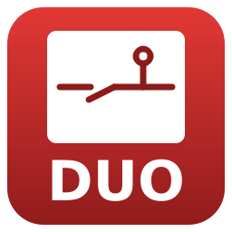
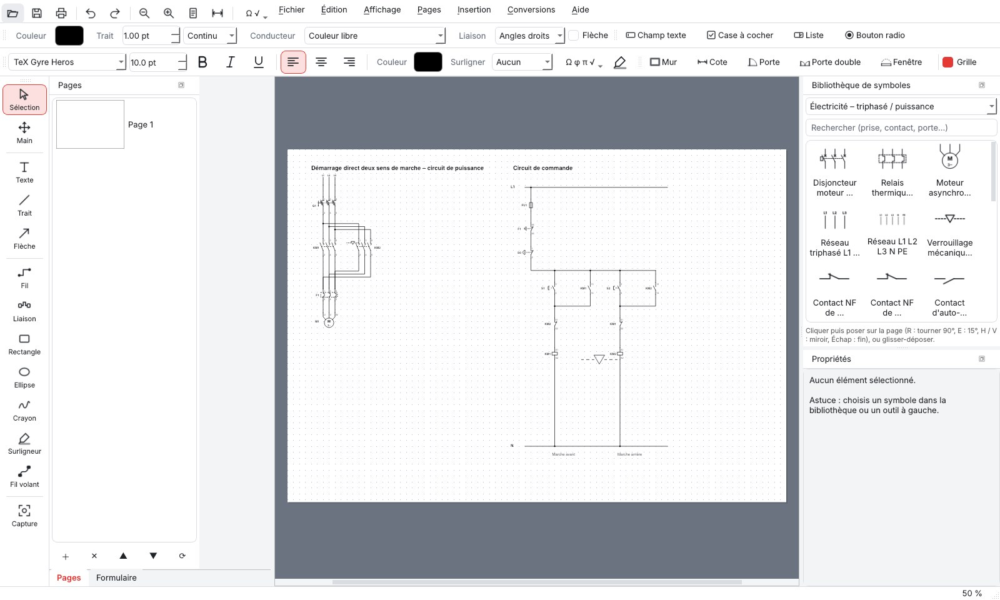

<p align="center"></p>

# PDF DUO

**Site : [deltapassion.github.io/PDF-DUO](https://deltapassion.github.io/PDF-DUO/)** · **Téléchargements : [Releases](https://github.com/Deltapassion/PDF-DUO/releases/latest)**

Logiciel libre pour **lire, annoter, signer et remplir des PDF**, **dessiner des schémas électriques, pneumatiques,
réseau, des GRAFCET et des plans de logement**, et **convertir Word / ODF ↔ PDF**.
Pensé pour l'enseignement en lycée professionnel (bacs pro MELEC et CIEL).

*Jacques Branas, en collaboration avec Claude.ai* — licence GNU GPL v3 ou ultérieure.



## Fonctions (version 1.0.0)

- **PDF** : ouvrir, zoomer, faire défiler, imprimer ; PDF protégés par mot de passe.
- **Annoter / dessiner** : texte, trait, flèche, fil de schéma à angles droits, rectangle, ellipse,
  crayon, surligneur, image.
- **Rotation libre sur 360°** et **miroir** horizontal / vertical de tout élément
  (R = 90°, E = 15°, H / V = miroir, angle précis au dixième de degré dans Propriétés).
- **Grille et aimantation** (pas de 2,5 mm pour les schémas, 1 mm, 5 mm, ou pas réels de 10 / 25 / 50 cm pour les plans).
- **Bibliothèques de symboles** (364 symboles et 31 formes avec texte) :
  - Électricité – schémas : contacts NO / NF, boutons poussoirs, bobine KM, relais thermique,
    fusible, disjoncteur, lampe, résistance, condensateurs, diodes, LED, transistors, moteur,
    transformateur, appareils de mesure, masse, terre…
  - Fonctions logiques : ET, OU, NON, NON-ET, NON-OU, OU exclusif, en norme CEI et en forme américaine.
  - Plan électrique – logement : prises 2P+T, prises spécialisées, 32 A, RJ45, TV, interrupteurs simple
    allumage, double allumage, va-et-vient, poussoir, variateur, point lumineux DCL, applique, spot,
    tableau, AGCP, compteur, télérupteur, DAAF, VMC, convecteur, chauffe-eau, volets…
  - Architecture – plan (à l'échelle 1/20 à 1/500) : portes (largeur et épaisseur de mur réglables),
    porte double, coulissante, de garage, fenêtres 1 et 2 vantaux, baie coulissante, escalier,
    sanitaires, cuisine, mobilier, flèche Nord.
- **Murs à l'échelle** (épaisseur en cm) et **cotes** affichant la longueur réelle.
- **Repères** (KM1, S1, H2…) sur les symboles, qui restent lisibles quand on tourne le symbole.
- **Capture d'une zone** en image (presse-papiers, collage sur la page, ou PNG).
- **Copier-coller** : les éléments se recollent dans PDF DUO **et** comme image dans Word ou LibreOffice.
- **Signature** dessinée à la souris / au stylet, ou importée ; mémorisable.
- **Formulaires** : remplir les champs d'un PDF, créer des champs texte et des cases à cocher.
- **Pages** : insérer, dupliquer, supprimer, déplacer, pivoter, fusionner des PDF, extraire, diviser.
- **Conversions** : Word / ODT → PDF, PDF → Word (.docx), PDF → ODT, Word ↔ ODT, images → PDF, pages → PNG.
  Word → PDF marche même sans LibreOffice : PDF DUO utilise alors Microsoft Word s'il est installé, sinon sa propre
  conversion (texte, titres, listes, tableaux, images, en-têtes ; mise en page simplifiée). PDF → Word n'a jamais besoin de LibreOffice.
- **Liaisons** : les fils s'accrochent aux bornes des symboles et les suivent quand on déplace un symbole ;
  outil *Liaison* (clic sur une borne, puis l'autre : tracé automatique à angles droits) ;
  points de jonction automatiques.
- **Couleurs de conducteurs** normalisées (phase marron / noir / gris / rouge, neutre bleu, terre vert-jaune rayé,
  retour lampe, navette…) et épaisseur réglable.
- **Numéros de bornes** (A1 / A2, 13-14, 21-22, 1-2, 3-4…) toujours lisibles, repère placé automatiquement à côté.
- **Palette d'écriture** : police, taille, gras, italique, souligné, alignement, couleur, surlignage du texte.
- **Zones interactives** : champ texte, case à cocher, liste déroulante, bouton radio, zone de signature, lien
  (vers une page ou une adresse web).
- **Interface moderne** : thèmes clair, sombre, bleu nuit, sable ; couleur d'accent et fond de travail au choix ;
  palettes affichables / masquables (Affichage › Palettes).
- **Langues** : français, anglais, espagnol, portugais, allemand, italien (Affichage › Langue).
- **Triphasé / puissance** : sectionneur porte-fusibles, contacteur tripolaire, disjoncteur moteur, relais thermique,
  moteur asynchrone 3~, réseau L1 L2 L3 N PE, verrouillage mécanique, contacts de verrouillage électrique 61-62 / 51-52,
  auto-maintien 13-14, contacts F 95-96 / 97-98, arrêt d'urgence, bobines A1/A2, bornier, transformateur de commande.
- **Réseau informatique (CIEL)** : poste, portable, serveur, switch, routeur, Wi-Fi, box, pare-feu, Internet, imprimante,
  téléphone IP, caméra IP, NAS, hub, panneau de brassage, baie, API, CPL, prise RJ45.
- **GRAFCET** : étape initiale, étape, transition + réceptivité, actions (S/R, D, C), divergences ET / OU, macro-étape,
  renvoi, commentaire ; **Ctrl+G** ajoute transition + étape sous l'étape sélectionnée, déjà reliées et numérotées.
- **Algorigramme**, **logigramme** (portes à 2 et 3 entrées, mémoire RS) et **carte mentale** (liaisons courbes).
- **Portes et fenêtres dans les murs** : elles s'alignent sur le mur, prennent son épaisseur et s'ouvrent du côté de la souris.
- **Zones interactives remplissables dans PDF DUO** (double-clic ou panneau Formulaire) ; les valeurs saisies ensuite
  dans Acrobat ou un navigateur sont relues à la réouverture.
- **Commandes d'éclairage (schéma développé)** : va-et-vient, permutateur, double allumage, télérupteur et minuterie
  (bobines A1/A2 et contacts de puissance), contact temporisé au repos.
- **Tableau / protection** (neutre toujours à gauche) : disjoncteurs divisionnaires uni, P+N, bi, tri, tétra
  (repère ×, thermique ⊐, magnétique ⊃) ; interrupteurs et disjoncteurs différentiels ; coupe-circuit et sectionneurs
  porte-fusibles uni, P+N, 2P, tri, tétra avec contacts de pré-coupure et poignée ; symboles de base (interrupteur,
  sectionneur, contacteur, disjoncteur, interrupteur-sectionneur, interrupteur-fusible, sectionneur-fusible, rupteur,
  fusible à percuteur) ; parafoudre ; contacteur complet.
- **Plaque à bornes moteur** (U1 V1 W1 / W2 U2 V2, PE) et **barrettes** pour réaliser les couplages étoile / triangle,
  plus deux plaques corrigées.
- **Sciences** : multimètre (grandeur et valeur affichée réglables), oscilloscope (signaux des 2 voies), GBF (forme et
  fréquence), alimentation stabilisée 0-30 V, piles 9 V et 1,5 V, rhéostat ; verrerie de chimie avec niveau de liquide
  réglable (bécher, erlenmeyer, ballons, éprouvette, fiole jaugée, tube…), agitateur magnétique, burette, potence… ;
  optique (lentilles, miroirs, prisme, rayons, objet AB…) ; mécanique (masses, ressort, poulie, plan incliné, forces…).
- **Caractères spéciaux** (Ω ω Φ φ Π π Δ μ ° ± ≈ ≤ ≥…) et **racine carrée sur tout le nombre** : écrire √{…}.
- **Agrandissement proportionnel à la souris** : poignée bleue en bas à droite de l'élément sélectionné (Maj = proportionnel aussi pour rectangles et champs).
- **Oscilloscope** : tension sinusoïdale, continue, triangle, créneau, carrée alternative, dent de scie, redressée simple et double alternance ; **symboles continu ⎓ et alternatif ∼** ; **pile 4,5 V**.
- **Boutons toujours visibles dans la barre de menus** : ouvrir, enregistrer, imprimer, annuler, rétablir, zoom −/+, page entière, pleine largeur, caractères spéciaux.
- **Fil volant** (outil à main levée, tracé lissé, fiches banane aux deux bouts) pour les schémas de montage.
- **Cartouche d'un seul bloc** (titre, auteur, établissement, classe, date, échelle, folio), posé en bas à droite de la page.
- **Schémas réseau CIEL (vidéosurveillance, fibre)** : convertisseur de média fibre, châssis, switch PoE, caméras bullet et dôme,
  NVR, poste de supervision, moniteur, opérateur, antenne, routeur 4G, onduleur, tiroir optique ; zones en pointillé avec
  titre, étiquettes de câble ; couleurs de câble fibre / Ethernet / coaxial (exemple-reseau.pdf).
- **Pneumatique (ISO 1219)** : distributeurs 2/2, 3/2, 4/2, 5/2, 5/3 (bouton poussoir, galet, levier, coup de poing,
  électrique, pilotage pneumatique, ressort), vérins simple / double effet, amortis, double tige, rotatif, ventouse,
  source, compresseur, échappement, silencieux, réservoir, FRL, filtre, régulateur, lubrificateur, manomètre, pressostat,
  clapet anti-retour, réducteur de débit, étrangleur, cellules OU / ET, bloqueur, conduites de travail et de pilotage.
- **Recherche dans toute la bibliothèque** : taper un mot (« urgence », « vérin »…) cherche dans toutes les catégories.
- **Aéronautique – câblage** : disjoncteurs à bouton, connecteurs P / J, connecteur multibroches et circulaire, épissure,
  masse structure GD, métallisation, fil blindé, paires torsadées, cosse, bornier, barre bus, relais, générateur, batterie…
- **Annuler / rétablir** illimité (150 étapes).

Les dessins sont enregistrés **en vectoriel** dans le PDF (nets à toutes les échelles et à l'impression).
Le fichier garde aussi une copie modifiable : en le rouvrant dans PDF DUO, tous les éléments
se déplacent et se modifient encore. *Fichier › Exporter un PDF final* produit un PDF aplati, sans ces données.

## Télécharger

| Système | Fichier |
|---|---|
| Windows 10 / 11 | [PDF-DUO-Windows-Setup.exe](https://github.com/Deltapassion/PDF-DUO/releases/latest/download/PDF-DUO-Windows-Setup.exe) (installeur) · [PDF-DUO-Windows.zip](https://github.com/Deltapassion/PDF-DUO/releases/latest/download/PDF-DUO-Windows.zip) (portable) |
| Linux Debian / Ubuntu / Mint | [pdf-duo_amd64.deb](https://github.com/Deltapassion/PDF-DUO/releases/latest/download/pdf-duo_amd64.deb) |
| Linux (toutes distributions) | [PDF-DUO-x86_64.AppImage](https://github.com/Deltapassion/PDF-DUO/releases/latest/download/PDF-DUO-x86_64.AppImage) · [PDF-DUO-Linux-x86_64.tar.gz](https://github.com/Deltapassion/PDF-DUO/releases/latest/download/PDF-DUO-Linux-x86_64.tar.gz) |
| macOS Apple Silicon (M1, M2…) | [PDF-DUO-macOS-AppleSilicon.zip](https://github.com/Deltapassion/PDF-DUO/releases/latest/download/PDF-DUO-macOS-AppleSilicon.zip) |
| macOS Intel | [PDF-DUO-macOS-Intel.zip](https://github.com/Deltapassion/PDF-DUO/releases/latest/download/PDF-DUO-macOS-Intel.zip) |

Ces versions sont fabriquées automatiquement par GitHub à chaque étiquette `v…` (fichier `.github/workflows/release.yml`).
Sur macOS, au premier lancement : clic droit sur l'application › Ouvrir. Pour des conversions Word les plus fidèles et pour l'ODT, installer
aussi **LibreOffice** (gratuit).

**Notice d'utilisation illustrée de captures d'écran** en six langues : [français](https://deltapassion.github.io/PDF-DUO/notice/?lang=fr) ·
[English](https://deltapassion.github.io/PDF-DUO/notice/?lang=en) ·
[español](https://deltapassion.github.io/PDF-DUO/notice/?lang=es) ·
[português](https://deltapassion.github.io/PDF-DUO/notice/?lang=pt) ·
[Deutsch](https://deltapassion.github.io/PDF-DUO/notice/?lang=de) ·
[italiano](https://deltapassion.github.io/PDF-DUO/notice/?lang=it) — aussi dans le logiciel : *Aide › Notice d'utilisation* (F1).

**Soutenir le projet** : PDF DUO est gratuit ; un don sur [Ko-fi](https://ko-fi.com/djlatinjazz) aide à le faire évoluer.

## Lancer depuis le code source

Il faut **Python 3.9 ou plus récent**.

```
pip install -r requirements.txt
python3 pdfduo.py
```

```text
Exemples fournis : dossier exemples/ (inversion de sens de marche, GRAFCET, réseau de vidéosurveillance)
```

Linux (Debian, Ubuntu, Mint) : `sudo apt install libreoffice python3-pip` puis les deux commandes ci-dessus
(ajouter `--break-system-packages` à `pip` si le système le demande, ou utiliser un environnement virtuel).

## Remarques

- La conversion PDF → Word reconstruit paragraphes, tableaux et images. Elle est très bonne sur un PDF
  « texte » ; un PDF scanné (image) demandera une reconnaissance de caractères (prévue plus tard).
- Bibliothèques utilisées : Qt / PySide6 (LGPL), PyMuPDF (AGPL), pdf2docx (MIT), LibreOffice (MPL).

## Du même auteur

[**Platine Duo**](https://deltapassion.github.io/Platine-Duo/) — logiciel libre de mix DJ, créé lui aussi avec Claude.ai.
